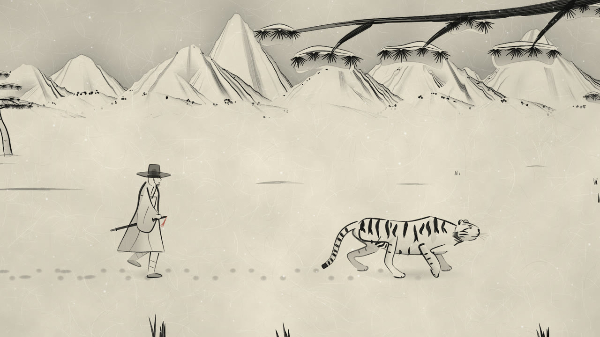
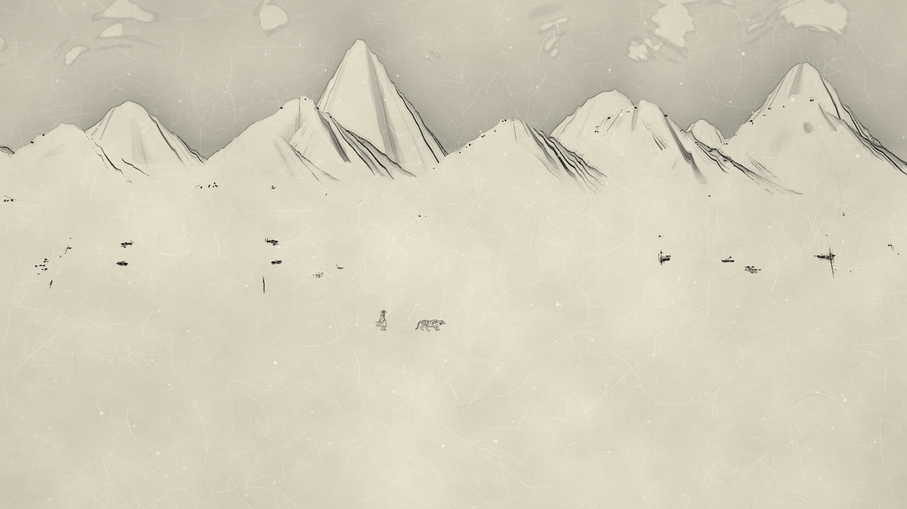
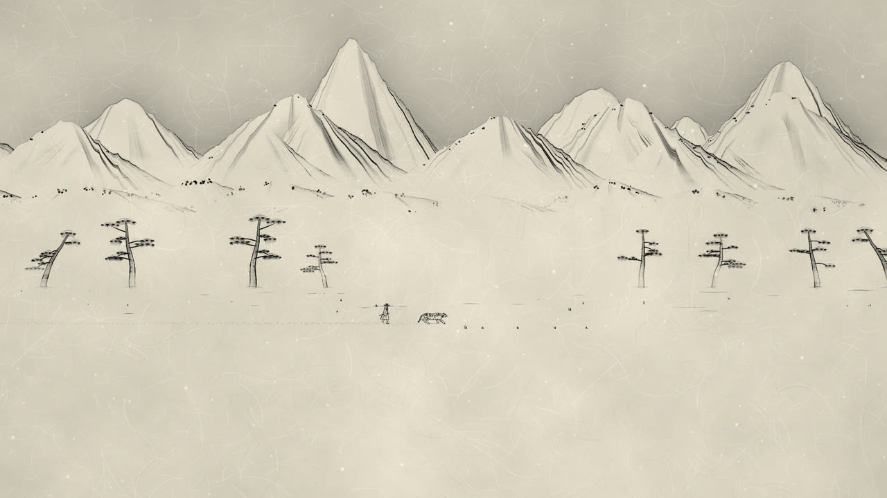
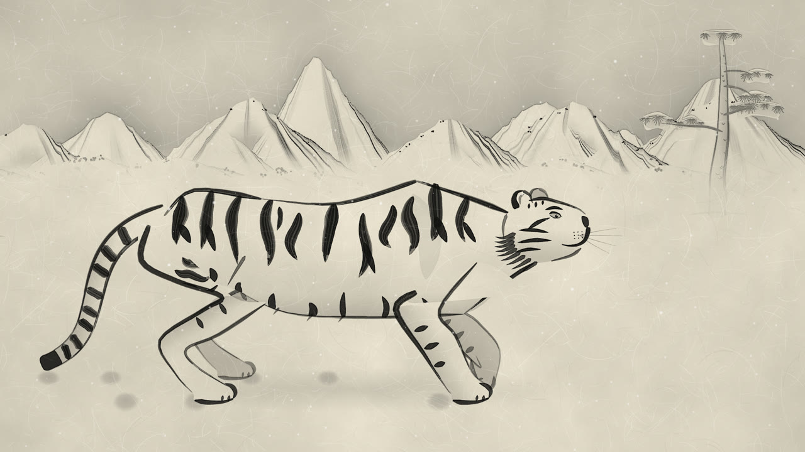
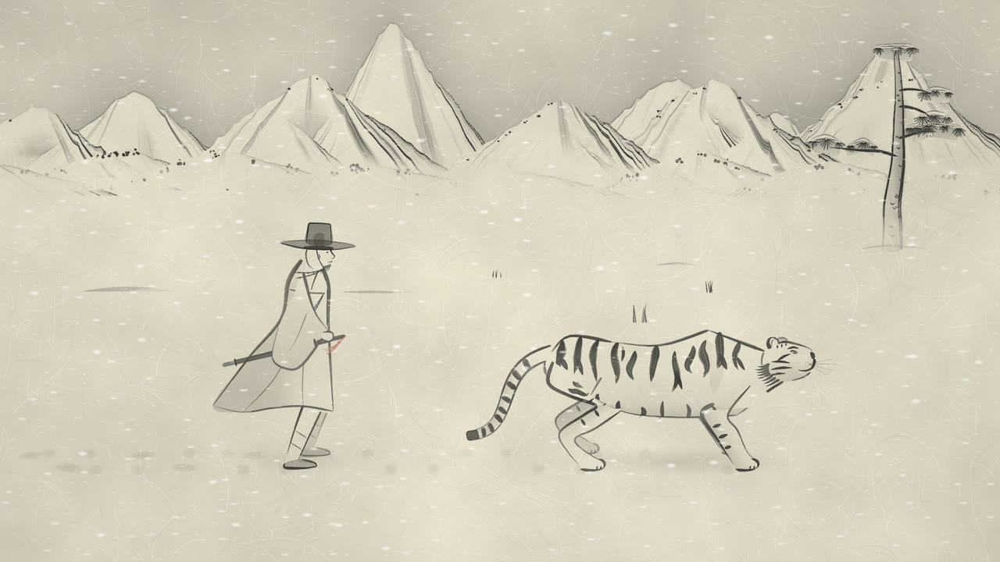
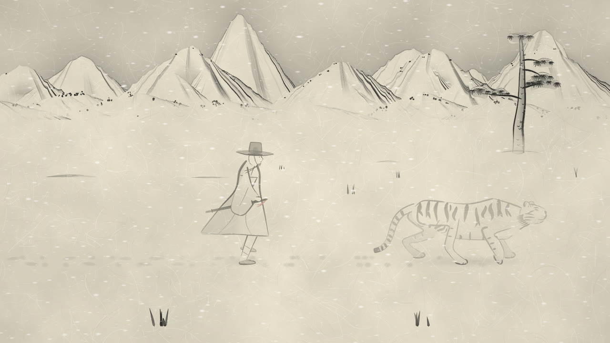
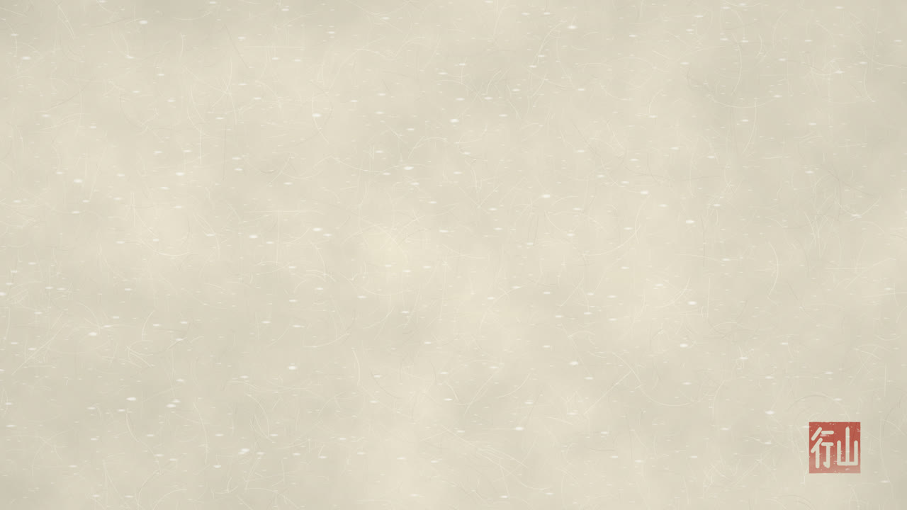

<div align="center">

# 雪中同行 · 설중동행

**한지 위 먹으로 그린 수묵화가 그대로 살아 움직이는 33초 웹 애니메이션**

눈 덮인 산길을 말없이 함께 걷는 호랑이와 나그네

[](https://jeiel85.github.io/seoljung-donghaeng/)
[](index.html)
[](LICENSE)



</div>

---

## 어떤 작품인가

조선 시대 산수화의 먹 번짐과 풍속화의 간결한 인물 필선을 참조해, **코드로만** 그린 수묵 애니메이션입니다.
생성형 AI 이미지·영상 모델이나 외부 그림 파일 없이, 산·소나무·호랑이·나그네·한지 결·낙관까지 전부 브라우저에서 절차적으로 그립니다.
배경음(바람, 눈 밟는 소리, 호랑이 숨, 대금풍 선율, 뜯는 현)도 Web Audio로 직접 합성합니다.

색은 먹과 한지 색뿐이고, 유일한 포인트 색은 **나그네의 칼에 달린 붉은 술**과 **마지막 낙관(山行)** 입니다.

| | |
|:-:|:-:|
|  |  |
| **0–6초** 젖은 종이에 먹이 번지듯 설산이 나타난다 | 넓은 설원을 둘이 작게 가로지른다 |
|  |  |
| **15–20초** 눈을 깜빡이고 입김을 내뱉다 멈춰 고개를 든다 | **20–27초** 바람에 도포 자락과 갓끈이 날리고, 호랑이가 귀를 움찔한다 |
|  |  |
| **27–31초** 다시 걸어 눈보라 속으로 사라진다 | **31–33초** 빈 한지로 돌아가고 붉은 낙관이 찍힌다 |

🎬 전체 영상(1080p, 사운드 포함): [`media/seoljung-donghaeng.mp4`](media/seoljung-donghaeng.mp4)

## 감상하기

- 웹: **<https://jeiel85.github.io/seoljung-donghaeng/>** — `▶ 감상하기`를 누르면 소리와 함께 재생됩니다(스페이스 키도 가능).
- 로컬: `index.html` 하나만 브라우저로 열면 됩니다. 빌드·서버·네트워크가 필요 없습니다.
- 특정 장면 고정: `index.html?t=17.5` 처럼 초 단위 시각을 주면 그 프레임을 정지 화면으로 그립니다.

> WebGL을 지원하는 최신 브라우저(Chrome·Edge·Firefox·Safari)가 필요합니다. 첫 로딩 때 산·소나무·한지를 생성하느라 몇 초가 걸립니다.

## 어떻게 그렸나

```
Canvas2D ─ 먹 농도 레이어 ─┐
  · 배경(산·소나무·설원·발자국)   │  WebGL 셰이더 합성
  · 인물(호랑이·나그네·입김·낙관)  ├─▶ 한지 질감 · 번짐 · 고인 테두리 · 섬유 결
                               │      · 안개 · 눈보라 · 눈송이
Web Audio ─ 전 구간 미리 합성 ──┘      (같은 시계로 동기화)
```

| 요소 | 방법 |
|---|---|
| **붓** | 필압 곡선(눌렀다 떼는 굵기 변화) + 붓털 갈래 + 마른 붓 끊김. 굵기가 일정한 윤곽선은 쓰지 않습니다. 같은 획은 같은 씨앗값으로 그려 프레임마다 모양이 바뀌지 않습니다. |
| **먹** | 레이어 알파에 농도를 싣고, 셰이더가 주변 농도와의 차이로 *먹이 고인 테두리*를, 한지 섬유 지도로 *먹이 덜 먹는 결*을 만듭니다. |
| **번짐 등장·소멸** | 배경 픽셀마다 '번지기 시작하는 시각'을 R 채널에 구워 두고, 진한 곳부터 흐린 곳으로 들쭉날쭉한 앞선(먹이 고인 선)을 그리며 번져 나옵니다. 마지막에는 거꾸로 흐린 곳부터 종이로 돌아갑니다. |
| **산** | 눈 덮인 양지는 종이 여백으로 남기고, 능선에서 갈라져 내려오는 산줄기의 그늘진 면에만 준법 같은 결을 씁니다. 하늘은 엷게 바림해 흰 봉우리를 띄우고(외훈), 산자락은 안개로 지웁니다. |
| **깊이** | 핀홀 카메라 투영으로 먼 산은 거의 움직이지 않고, 소나무 열·설원·앞쪽 풀·늘어진 솔가지 순으로 빠르게 지나갑니다. 안개·눈보라는 타일을 잇지 않는 한 장짜리 띠와 연속 잡음이라 세로 이음새가 없습니다. |
| **호랑이 보행** | 4족 측대 보행 순서(왼뒤→왼앞→오른뒤→오른앞). 발은 디딤 동안 세계 좌표에 고정되고, 닿지 않는 거리에서는 발을 끌지 않고 뼈를 미세하게 늘립니다. 어깨뼈·엉덩이는 디딤 다리를 따라 번갈아 솟습니다. 줄무늬는 몸 좌표(등→배)에 붙어 몸을 따라 휩니다. |
| **나그네** | 2족 보행(뒤꿈치 닿기→발끝 떼기), 무게감 있는 위아래 출렁임, 앞무릎이 앞자락을 밀어냄. 도포 자락·소매·갓끈·세조대·붉은 술은 스프링으로 시뮬레이션해 걸음과 바람에 늦게 따라옵니다. |
| **소리** | 필터 잡음 바람, 실제 발 디딤 시각에 맞춘 눈 밟는 소리(호랑이는 부드럽게, 사람은 뽀드득), 호랑이 날숨, 농음과 꺾는 소리가 있는 계면조 대금풍 선율, Karplus-Strong으로 뜯는 현과 농현, 산골짜기 잔향. 원곡을 쓰지 않았습니다. |

## 프레임 검사

마감 전에 다음을 확인했습니다. 도구: [`tools/capture.mjs`](tools/capture.mjs) (Playwright + 헤드리스 Chromium)

- 전 구간 무작위 스틸 검사, 걷는 구간 연속 프레임(콘택트 시트) 검사, 깜빡임·입김·귀 움찔 구간 확대 검사
- 디딤발 고정(보행 시뮬레이션 수치로 확인), 정지 시 네 발이 제자리로 정착하는지
- 소나무가 인물을 가리지 않는지, 꼬리와 나그네가 겹치지 않는지, 프레임 가장자리에서 다리가 잘리지 않는지
- 사운드: 통합 음량·피크·DC 오프셋·대역 분포

```bash
# playwright-core 경로를 지정한 뒤
node tools/capture.mjs stills  out 1920 3 11 17.5 23.5      # 스틸
node tools/capture.mjs sheet   walk.png 1920 12 0.0667 12 4  # 연속 프레임 시트
node tools/capture.mjs frames  frames 1920 30               # 영상용 전 프레임
node tools/capture.mjs wav     audio.wav                    # 합성 사운드
```

### 알려진 한계 (숨기지 않고 적어 둡니다)

- **필선의 즉흥성**: 붓질은 절차적으로 만든 것이라, 실제 화가의 즉흥적인 선맛·먹의 우연성에는 미치지 못합니다. 호랑이 줄무늬 배치도 손그림보다 다소 규칙적으로 보일 수 있습니다.
- **다리의 교차**: 걷는 동안 가까운 쪽·먼 쪽 다리가 지나치는 순간에는 화면상 겹칩니다(실제 보행의 자연스러운 교차). 먼 쪽 다리를 옅은 회색으로 그려 구분했지만, 작은 화면에서는 한 덩어리로 보일 수 있습니다.
- **근접 장면의 몸통 비례**: 호랑이를 통째로 프레임에 넣느라 근접 장면에서 몸통이 약간 길어 보입니다.
- **눈송이**: 셰이더 격자 방식이라 같은 깊이 층의 눈송이가 함께 같은 방향으로 흐릅니다.
- **성능**: 실시간 렌더링이라 저사양 기기에서는 프레임이 떨어질 수 있습니다(시간축은 오디오 시계를 따르므로 길이는 그대로입니다). 검사는 헤드리스 SwiftShader 렌더 기준이며, 실제 GPU 브라우저별 실시간 성능은 기기마다 다릅니다.

## 파일 구성

```
index.html            작품 본체 (단일 독립형 HTML, 외부 의존성 없음)
tools/capture.mjs     스틸·연속 프레임·영상 프레임·WAV 추출 도구
media/stills/         대표 스틸
media/*.mp4           사운드 포함 전체 영상 (위 도구로 렌더링)
```

## 라이선스

[MIT](LICENSE). 그림과 소리 모두 이 저장소의 코드가 직접 만든 것입니다.
